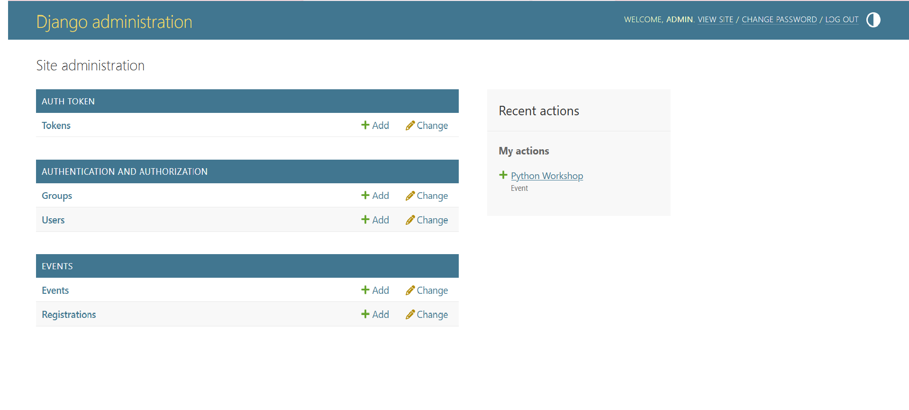
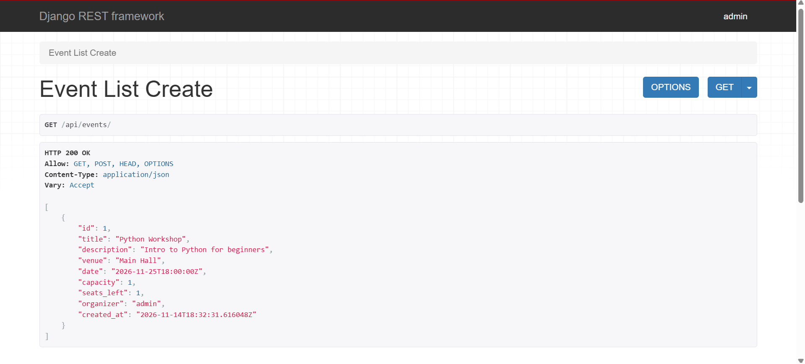
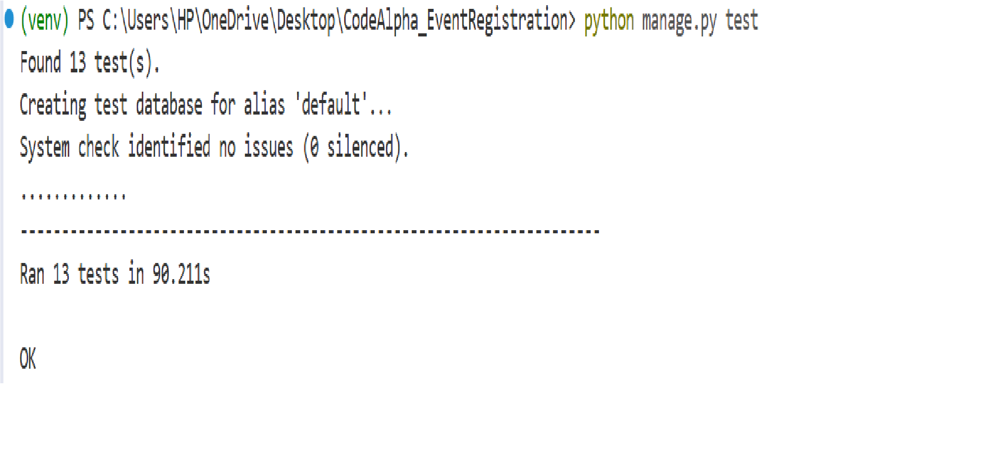

# Event Registration System

Backend project for the CodeAlpha Backend Development Internship (Task 2).
Users can browse events, register, and cancel. Organizers manage events
and see who registered.



## Features

- Token-based signup and login
- Public event list and event details
- Registration with rules: no duplicates, no registering when the event is full
- Cancelling a registration frees the seat, and the user can register again
- Users can only see and cancel their own registrations
- Staff can create events, and only the organizer can edit or delete them
- Organizers can see the attendee list of their own events
- Django admin panel with registrations shown inside each event



## Built with

Python, Django, Django REST Framework, SQLite, Token authentication.

## How to run

1. Clone this repo and open a terminal in the project folder.
2. Create and activate a virtual environment:
   ```
   python -m venv venv
   venv\Scripts\activate
   ```
3. Install the requirements:
   ```
   pip install -r requirements.txt
   ```
4. Create the database tables:
   ```
   python manage.py migrate
   ```
5. Create an admin account:
   ```
   python manage.py createsuperuser
   ```
6. Start the server:
   ```
   python manage.py runserver
   ```

Admin panel: http://127.0.0.1:8000/admin

## API endpoints

| Method | Endpoint | Access | What it does |
|--------|----------|--------|--------------|
| POST | `/api/auth/signup/` | Public | Create an account |
| POST | `/api/auth/login/` | Public | Get an auth token |
| GET | `/api/events/` | Public | List events |
| POST | `/api/events/` | Staff | Create an event |
| GET | `/api/events/<id>/` | Public | Event details |
| PUT/PATCH/DELETE | `/api/events/<id>/` | Organizer | Edit or delete an event |
| POST | `/api/events/<id>/register/` | Logged in | Register for an event |
| GET | `/api/events/<id>/attendees/` | Organizer | See who registered |
| GET | `/api/registrations/` | Logged in | My registrations |
| GET | `/api/registrations/<id>/` | Owner | One registration |
| DELETE | `/api/registrations/<id>/` | Owner | Cancel my registration |

Send the token in the header: `Authorization: Token <your-token>`

## Design decisions

- **Cancel changes the status instead of deleting the row.** This keeps history and lets a user register again later.
- **A database constraint blocks duplicate registrations**, so even a bug in the code cannot create two for the same user and event.
- **`transaction.atomic()` with `select_for_update()`** stops two people from taking the last seat at the same moment.
- **Other users' registrations return 404**, so nobody can find out which IDs exist.

## Tests

```
python manage.py test
```

13 automated tests cover registration, duplicates, full events, cancelling, permissions and event validation.



## Things I would add next

- Email confirmation after registering
- A waiting list for full events
- Search and filtering on the event list
- Pagination

## About me

Kashmala Farrukh, Backend Development intern at CodeAlpha.
LinkedIn: https://www.linkedin.com/in/kashmala-farrukh-29ab3536b/